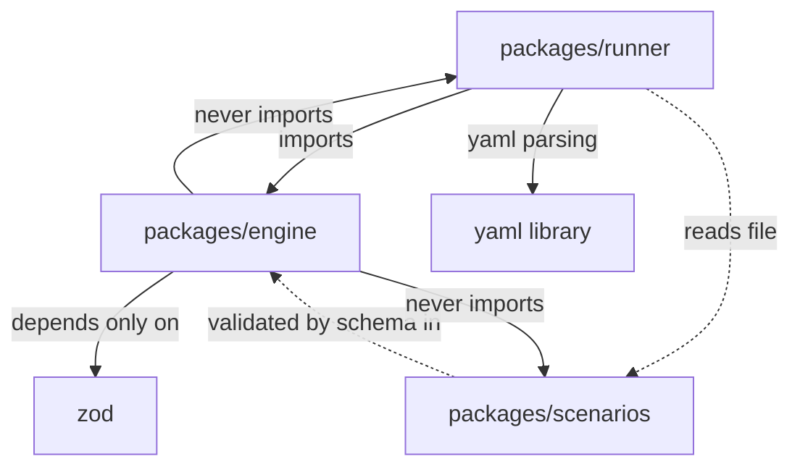
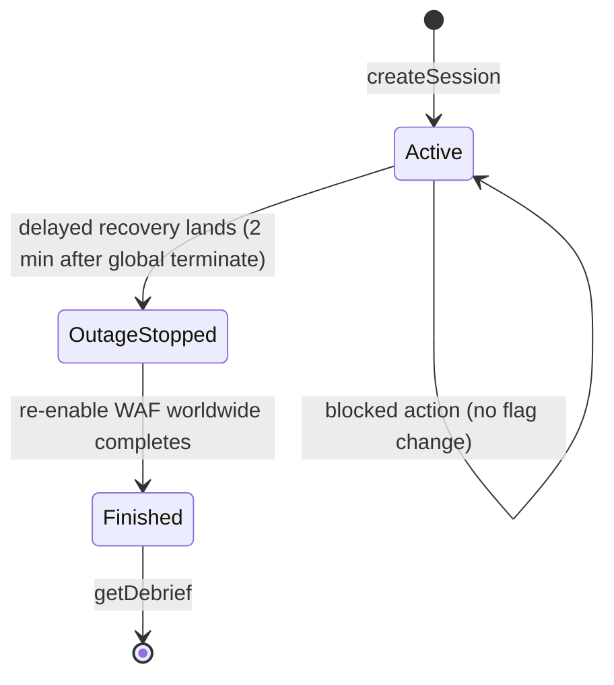
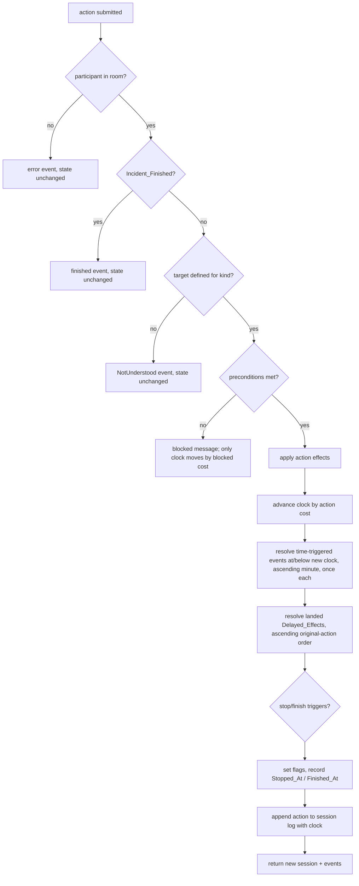
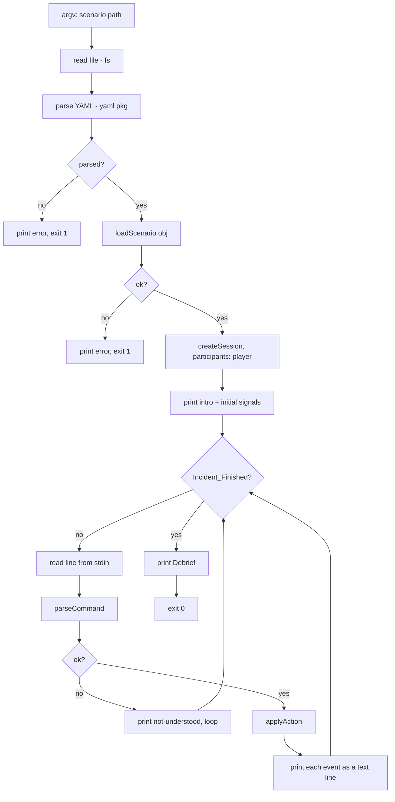

# Design Document — engine-scenario-one

## Research Summary

- **Zod error reporting**: `safeParse` returns structured issues, each with a `path` (schema path array), a `code`, and a `message` (see [zod.dev error formatting](https://zod.dev/error-formatting)). This satisfies Requirements 1.2 and 1.3 (name the field path; state the expected type) without custom machinery: we map Zod issues into our own `LoadError` values.
- **fast-check**: pure-function properties are the sweet spot; our engine is exactly that. We will use `fc.record`/`fc.constantFrom`/`fc.integer` generators built on a generator that produces *valid* random scenarios (see Testing Strategy).
- **Cloudflare postmortem**: the requirements document already encodes the timeline, targets, and costs from https://blog.cloudflare.com/details-of-the-cloudflare-outage-on-july-2-2019 ; this design maps them onto the schema without inventing new facts. Anything not in the postmortem carries `reconstruction: true`.

## Overview

Three packages are built in this spec:

1. **`packages/engine`** — the pure game engine. Zod schema + loader, session state, action dispatch, clock, delayed effects, reachability check, command parser, debrief. No I/O of any kind: no file reads, no YAML parsing, no stdin/stdout, no `Date.now`, no `Math.random`, no network.
2. **`packages/scenarios`** — the Cloudflare 2 July 2019 YAML file plus a shared Zod schema package export? No: the schema lives in the engine (the Loader owns validation). The scenarios package holds only data files.
3. **`packages/runner`** — the terminal CLI. Reads the YAML file, parses YAML text to a plain object (YAML_Parser step), passes the object to the engine's Loader, then runs a REPL loop against the engine.

The engine is the only place game rules exist. The runner contains zero game rules. The scenarios package contains zero logic.

## Architecture

### Package dependency graph



Solid arrows are compile-time imports; dashed arrows are runtime data flow (the runner reads a YAML file that the engine's schema validates). The engine imports only `zod`. The engine never imports the runner or the scenarios package; a scenario reaches the engine only as a plain in-memory object passed by a host.

### Boundaries (enforced by convention and lint)

- Engine: pure functions. Signature style is `f(input) -> output`; no function in the package may touch `fs`, `process.stdin/stdout`, `Date`, `Math.random`, or `fetch`. We will add an ESLint rule (`no-restricted-globals` for `Date`, `Math.random`; `no-restricted-imports` for `fs`, `node:*`) as a guardrail.
- Runner: all I/O. Reads the file with `fs.readFileSync`, parses YAML with the `yaml` npm package, prints with `console.log`/`process.stdout`.
- Scenarios: YAML data only, one file per outage.

### Session state machine



`Outage_Stopped` and `Incident_Finished` are flags on the session, not separate states in a union type; the reachable combinations are the four states above. Both flags are one-way (Requirement 7.7).

## Components and Interfaces

### Engine public API

```typescript
// packages/engine/src/index.ts — public exports

/** Validate an already-parsed scenario object. Runs the Reachability_Check. */
export function loadScenario(obj: unknown): LoadResult;

export type LoadResult =
  | { ok: true; scenario: Scenario }
  | { ok: false; error: LoadError };

export type LoadError =
  | { kind: 'schema'; issues: SchemaIssue[] }   // from Zod
  | { kind: 'unreachable' }
  | { kind: 'reference'; path: string; message: string }; // unresolved target ref

export type SchemaIssue = {
  path: string;      // e.g. "actions[3].target"
  code: string;      // zod issue code, e.g. 'invalid_type' | 'invalid_union'
  expected?: string; // e.g. 'string'
  message: string;
};

/** Create a session (shared room) from a valid scenario. */
export function createSession(
  scenario: Scenario,
  participants: Participant[]
): Session | { error: 'no-participants' };

/** Apply one action. Returns a NEW session; the input session is untouched. */
export function applyAction(
  session: Session,
  action: Action
): { session: Session; events: Event[] };

/** Debrief; available only after Incident_Finished. */
export function getDebrief(session: Session): Debrief | { error: 'not-finished' };

/** Pure command parser. */
export function parseCommand(
  line: string,
  scenario: Scenario
): ParsedCommand;
```

### Component responsibilities

| Component | Package | Responsibility |
|---|---|---|
| `schema.ts` | engine | Zod schema + type inference |
| `loader.ts` | engine | `loadScenario`: Zod validate, cross-reference checks, Reachability_Check |
| `reachability.ts` | engine | BFS over action graph (below) |
| `session.ts` | engine | `createSession`, session type |
| `dispatch.ts` | engine | `applyAction`: validation → preconditions → effects → clock → delayed effects |
| `clock.ts` | engine | clock advance, time-triggered and delayed-effect resolution |
| `parser.ts` | engine | `parseCommand` |
| `debrief.ts` | engine | `getDebrief` |
| `index.ts` | engine | public exports |
| `cli.ts` | runner | argument handling, REPL |
| `hostio.ts` | runner | file read, YAML parse, stdin/stdout wrappers (injectable for tests) |

### Action dispatch flow



Note: `help` and `wait` bypass target/precondition checks; `wait` advances the clock (which can fire time-triggered and delayed effects); `help` costs 0 minutes and never changes flags.

**Design decision — immutable sessions.** `applyAction` returns a new session value rather than mutating. The session carries the whole game state, so replaying a recorded action sequence always yields the same result (Requirement 11.1), and tests compare sessions structurally. Implementation will use plain object copies; performance is irrelevant at human action rates.

**Design decision — cost of `help` and `look` at repeated targets.** `help` costs 0. A `look` at an already-seen target still costs 1 minute (the scenario defines the cost; the engine does not special-case repeats).

## Data Models

### Core types

```typescript
// --- Action kinds (closed union) ---
export type ActionKind = 'look' | 'do' | 'help' | 'wait';

export type Action =
  | { kind: 'look'; target: string }
  | { kind: 'do'; target: string }
  | { kind: 'help' }
  | { kind: 'wait' };

export type Participant = { id: string };

// --- Scenario (the Zod schema shape; types inferred via z.infer) ---
export type Scenario = {
  id: string;                       // e.g. 'cloudflare-2019-07-02'
  title: string;
  source: {
    url: string;                    // postmortem URL
    title: string;
  };
  reconstructionNote: string;       // debrief context sentence (Req 12.2)
  initialSignals: TimeSignal[];     // signals present at clock 0
  signals: Signal[];                // all signals incl. time-triggered
  targets: {
    look: LookTarget[];             // 5 for Cloudflare
    do: DoTarget[];                 // see Req 12.5
  };
  stop: {
    triggerAction: string;          // 'global-terminate-waf' do-target id
  };
  finish: {
    triggerAction: string;          // 're-enable-waf-worldwide'
  };
  costs: {
    wait: number;                   // minutes
    blocked: number;                // minutes for blocked attempts
  };
  costsAreEstimates: boolean;       // true: all action costs are reconstructions
  sourceDurations: {
    pageToIdentified: number;       // minutes, from source
    pageToSwitchOff: number;        // minutes, from source
    pageToRecovery: number;         // minutes, from source
    switchOffToWafRestored: number; // minutes, from source
    outageFromDeploy: number;       // minutes, stated in source
  };
  realTimeline: RealTimelineEntry[];
};

export type Signal = {
  id: string;
  text: string;
  arrivesAtMinute?: number;         // undefined => present from clock 0
  reconstruction?: boolean;          // true when arrival minute is not in the source
};

export type LookTarget = {
  id: string;                       // e.g. 'alert-list'
  name: string;                     // 'the alert list'
  description: string;              // revealed text, first look
  descriptionOnRepeat?: string;     // optional, later looks
  cost: 1;                           // minutes
  reconstruction?: boolean;
};

export type DoTarget = {
  id: string;
  name: string;
  description: string;              // outcome text on success
  cost: number;                      // minutes per Req 12.5
  requires?: string[];              // ids of do-targets that must be DONE first
  outcome:
    | { kind: 'reveals'; text: string }                      // e.g. pull live CPU data
    | { kind: 'dead-end'; text: string }                      // treat as attack
    | { kind: 'fails'; text: string }                         // control panel login
    | { kind: 'delayed'; effect: DelayedEffectSpec }         // global terminate
    | { kind: 'progress'; flag: string }                     // generic milestone
    | { kind: 'finish' };                                    // re-enable WAF
  reconstruction?: boolean;
};

export type DelayedEffectSpec = {
  delayMinutes: number;              // 2 for the WAF recovery
  text: string;                      // event text when it lands
  setsFlag: 'outage_stopped';        // which session flag it sets on landing
};

export type RealTimelineEntry = {
  utcTimestamp: string;              // '13:31'
  description: string;
  reconstruction?: boolean;
};

// --- Session ---
export type Session = {
  scenario: Scenario;
  room: {
    participants: Participant[];     // shared-room model (Req 3)
  };
  clock: number;                    // Incident_Clock, whole minutes, starts 0
  outageStopped: boolean;
  incidentFinished: boolean;
  stoppedAt: number | null;
  finishedAt: number | null;
  actionLog: ActionLogEntry[];
  seenSignals: string[];             // signal ids already delivered
  firedTimeTriggers: string[];       // time-trigger ids, once each (Req 6.5)
  doneTargets: string[];             // completed do-target ids (for `requires`)
  lookedTargets: string[];           // for repeat descriptions
  pendingEffects: PendingEffect[];   // Delayed_Effects not yet landed
  flags: Record<string, boolean>;    // generic progress flags
};

export type ActionLogEntry = {
  action: Action;
  participantId: string;
  clockAtAction: number;
};

export type PendingEffect = {
  landsAtMinute: number;
  sourceActionId: string;
  sequence: number;                  // original-action order (Req 6.9)
  effect: DelayedEffectSpec;
};

// --- Events ---
export type Event =
  | { kind: 'text'; text: string }
  | { kind: 'signal'; signalId: string; text: string }
  | { kind: 'blocked'; message: string }
  | { kind: 'not-understood'; input: string }
  | { kind: 'error'; message: string }        // e.g. unknown participant (Req 3.5)
  | { kind: 'stop'; text: string; clock: number }
  | { kind: 'finish'; text: string; clock: number }
  | { kind: 'finished-already' }               // action after finish (Req 4.6)
  | { kind: 'help'; lines: string[] };

// --- Debrief ---
export type Debrief = {
  actionLog: ActionLogEntry[];               // Req 8.2
  realTimeline: RealTimelineEntry[];         // Req 8.3 (UTC + description)
  sourceUrl: string;                        // Req 8.4
  reconstructionNote: string;                // Req 8.5
  stoppedAt: number;                        // Req 8.6
  finishedAt: number;                       // Req 8.6
  sourceDurations: Scenario['sourceDurations']; // durations stated/derived in the source
};

// --- Command parser ---
export type ParsedCommand =
  | { ok: true; action: Action }
  | { ok: false; reason: 'not-understood'; input: string };
```

### Zod schema (structure)

The schema mirrors the types above; key decisions:

- `targets.look` and `targets.do` are arrays; after Zod validation, cross-reference checks run in the Loader (Zod `superRefine` can do it, but we keep it in loader code so error messages can name the unresolved reference, per Req 1.4): every `DoTarget.requires` id must exist in `targets.do`; every `Signal.id` unique; every `id` unique across look and do lists (Req 12.5 forbids overlap).
- `stop.triggerAction` and `finish.triggerAction` must reference existing do-target ids.
- Time-trigger minutes: `z.number().int().min(0)` (Req 1.5: negative minute rejected).
- `reconstruction: true` marker: the Loader enforces the *presence* of the flag where required by making the field optional-but-checked per-entry; Req 12.10 is verified for scenario one by a dedicated example test, not by schema (the schema cannot know what the source postmortem says).

```typescript
export const ScenarioSchema = z.object({
  id: z.string().min(1),
  title: z.string().min(1),
  source: z.object({ url: z.string().url(), title: z.string() }),
  reconstructionNote: z.string().min(1),
  initialSignals: z.array(z.string()),
  signals: z.array(SignalSchema),
  targets: z.object({ look: z.array(LookTargetSchema), do: z.array(DoTargetSchema) }),
  stop: z.object({ triggerAction: z.string() }),
  finish: z.object({ triggerAction: z.string() }),
  costs: z.object({ wait: z.number().int().min(0), blocked: z.number().int().min(0) }),
  costsAreEstimates: z.boolean(),
  sourceDurations: z.object({
    pageToIdentified: z.number().int().min(0),
    pageToSwitchOff: z.number().int().min(0),
    pageToRecovery: z.number().int().min(0),
    switchOffToWafRestored: z.number().int().min(0),
    outageFromDeploy: z.number().int().min(0),
  }),
  realTimeline: z.array(RealTimelineEntrySchema),
});
export type Scenario = z.infer<typeof ScenarioSchema>;
```

Zod issues map to `SchemaIssue` with `path.join('.')`; the `expected` type string comes from the issue's `expected` field (v4) or is derived from `code`/`message` (v3) — one small adapter function in `loader.ts`.

### Scenario YAML shape (Cloudflare)

```yaml
# packages/scenarios/cloudflare-2019-07-02.yaml
id: cloudflare-2019-07-02
title: "Cloudflare outage, 2 July 2019"
source:
  url: https://blog.cloudflare.com/details-of-the-cloudflare-outage-on-july-2-2019
  title: "Details of the Cloudflare outage on July 2, 2019"
reconstructionNote: >-
  This reconstruction compresses a multi-team response into one player.
  The real response involved teams across Cloudflare...
initialSignals: [sig-page]
signals:
  - { id: sig-page, text: "PAGERDUTY: outside WAF test failing", arrivesAtMinute: 0 }
  - { id: sig-traffic, text: "...", arrivesAtMinute: 2, reconstruction: true }
  # ... six signals per Req 12.3, signals 2-6 marked reconstruction: true
targets:
  look:
    - { id: alert-list, name: "the alert list", description: "...", cost: 1 }
    - { id: traffic-level, ... }
    - { id: cpu-graph, ... }
    - { id: control-panel, name: "the internal control panel", ... }
    - { id: status-page, ... }
  do:
    - { id: declare-p0, name: "declare a P0 and escalate", cost: 2, outcome: { kind: progress, flag: p0-declared }, description: "..." }
    - { id: pull-cpu-data, name: "pull live CPU data", cost: 3, outcome: { kind: reveals, text: "..." } }
    - { id: process-trace, name: "run a process trace", cost: 3, outcome: { kind: reveals, text: "..." } }
    - { id: waf-error-logs, name: "read the WAF error logs", cost: 3, outcome: { kind: reveals, text: "..." } }
    - { id: change-tickets, name: "check the change tickets", cost: 2, requires: [use-bypass], outcome: { kind: reveals, text: "..." } }
    - { id: treat-as-attack, name: "treat it as an attack", cost: 8, outcome: { kind: dead-end, text: "..." } }
    - { id: panel-login, name: "try the control panel login", cost: 2, outcome: { kind: fails, text: "..." } }
    - { id: use-bypass, name: "use the bypass", cost: 3, outcome: { kind: progress, flag: bypass-used } }
    - id: global-terminate-waf
      name: "globally terminate the WAF"
      cost: 1
      requires: [use-bypass]
      outcome:
        kind: delayed
        effect: { delayMinutes: 2, text: "CPU and traffic return to normal.", setsFlag: outage_stopped }
      description: "..."
    - { id: follow-rollback, name: "follow the rollback plan", cost: 20, outcome: { kind: dead-end, text: "Too slow: the rollback needs the full WAF build twice; the outage would outlast it." } }
    - { id: test-one-city, name: "test the fix in one city", cost: 40, requires: [global-terminate-waf], outcome: { kind: progress, flag: city-tested } }
    - { id: re-enable-waf, name: "re-enable the WAF worldwide", cost: 5, requires: [test-one-city], outcome: { kind: finish } }
    - { id: update-status-page, name: "update the status page", cost: 2, outcome: { kind: progress, flag: status-updated } }
stop: { triggerAction: global-terminate-waf }
finish: { triggerAction: re-enable-waf }
costs: { wait: 1, blocked: 1 }
costsAreEstimates: true
sourceDurations:
  pageToIdentified: 15        # minutes, from source
  pageToSwitchOff: 22         # minutes, from source
  pageToRecovery: 24          # minutes, from source
  switchOffToWafRestored: 45  # minutes, from source
  outageFromDeploy: 27        # minutes, stated in source (from 13:42 deploy)
realTimeline:
  - { utcTimestamp: "13:31", description: "Change merged after approval." }
  - { utcTimestamp: "13:37", description: "Build passes." }
  - { utcTimestamp: "13:42", description: "Deployed everywhere." }
  - { utcTimestamp: "13:45", description: "First page sent.", reconstruction: true }
  - { utcTimestamp: "14:00", description: "WAF identified as cause." }
  - { utcTimestamp: "14:02", description: "Global terminate proposed." }
  - { utcTimestamp: "14:07", description: "Global terminate executed." }
  - { utcTimestamp: "14:09", description: "Traffic and CPU back to normal." }
  - { utcTimestamp: "14:52", description: "WAF re-enabled worldwide." }
```

(Target texts are placeholders here; the scenario task will write real copy from the postmortem. IDs and costs are the contract.)

**Reconstruction markers**: `reconstruction: true` marks only entries whose content is not directly stated in the source postmortem. The minute costs of all actions are estimates, so that fact is stated once at scenario level via `costsAreEstimates: true` rather than per target. Signals 2–6 arrival minutes are reconstructions and are marked on each signal. The first page signal (`sig-page`, `arrivesAtMinute: 0`) is stated in the source and carries no marker. Real-timeline entries derived from the source (the 13:45 first page) carry their own marker.

**Precondition mapping**: `change-tickets` requires the bypass first (per Req 12.5: "check the change tickets (2 min, requires bypass first)"), `global-terminate-waf` requires the bypass, `test-one-city` requires the terminate, `re-enable-waf` requires the one-city test. `follow-rollback` is a slow dead end: the rollback needs the full WAF build twice, so following it cannot lead to finishing the incident; it is available but leads nowhere.

**Wait cost**: the scenario defines `costs.wait: 1` (reconstruction; the requirements leave the wait cost to the scenario).

## Reachability Check

The Loader runs a graph search over the abstract state space before accepting a scenario:

- **State** (for search only): `{ doneTargets: Set<string>, clock: number, finished: boolean }`. Flags derive from done targets, so done-set suffices.
- **Edges**: from any state, the applicable actions are (a) every do-target whose `requires` are all in the done-set (its outcome may add a flag/done-target), (b) `wait`. Time-triggered signals and delayed effects depend only on the clock, which only advances, so they never block progress.
- **Search**: BFS with a visited set keyed by done-set plus a clock-boundedness cutoff. Because the clock only rises and every do-target can be done at most once, the state space is finite: at most 2^|doTargets| done-sets, and the clock is bounded by the sum of all costs (a maxed clock with all targets done either finishes or cannot be the accepted case).
- **Accept** iff a state is reached where the finish trigger's requirements are met and performing it sets `Incident_Finished` (including the stop-before-finish ordering, which the engine enforces at runtime and the check models: the finish target's `requires` chain must transitively include the stop trigger's path, otherwise the scenario is rejected as unreachable-to-finish in valid order). Practically: BFS over done-sets, edge = "do target X (if requires ⊆ done)", accepting state = done-set containing `finish.triggerAction`'s requirements plus the stop flag being reachable earlier — modelled as: the finish edge is only available in states where the delayed stop effect has landed, i.e. where the stop trigger is in the done-set (since delayMinutes ≥ 1 and the finish action itself takes ≥ 1 minute, the stop effect always lands before or at the same action that finishes — verified during check by requiring `clock(stop) + delay ≤ clock(finish)`, which holds whenever the finish target requires the stop target transitively).
- **Cost**: exponential in the worst case, but scenario one has 13 do-targets ⇒ at most 8192 states; trivial. The check runs once per load.

If no accepting state exists, `loadScenario` returns `{ ok: false, error: { kind: 'unreachable' } }` and no session can be created (Req 2.2).

## Delayed Effect Scheduling and Resolution

- When a do-target with `outcome.kind === 'delayed'` completes at clock time `t`, dispatch appends a `PendingEffect { landsAtMinute: t + effect.delayMinutes, sequence: <monotone counter>, effect }` to `session.pendingEffects`. Nothing else happens at `t` (Req 6.6). The delay duration is defined solely on the do-target's `outcome.effect.delayMinutes` field; the `stop` block on the scenario carries only `triggerAction` and does not duplicate the delay value.
- On every clock advance to `newClock` (any action, including `wait`), resolution runs in this order:
  1. **Time-triggered signals** with `arrivesAtMinute ≤ newClock` and not in `firedTimeTriggers`: fire in ascending minute order, once each (Req 6.3–6.5).
  2. **Landed delayed effects** with `landsAtMinute ≤ newClock` and still pending: apply in ascending `sequence` (original-action order, Req 6.9), then in ascending `landsAtMinute` (sequence dominates only across equal minutes — spec says "same minute" ordering, so sort by `(landsAtMinute, sequence)`). Each applies exactly once (Req 6.8).
- When the stop effect lands, the engine sets `outageStopped = true`, records `stoppedAt = landsAtMinute` (the clock value at landing, Req 7.1/7.5), and emits a `stop` event in the response list of the action that advanced the clock to that minute (Req 7.1). The 2-minute delay is defined on the `global-terminate-waf` do-target's `outcome.effect` only — the single source of truth. The finish trigger sets `incidentFinished = true` and `finishedAt` when its action completes, but only if `outageStopped` is already true (Req 7.3). Since the stop effect lands at `t_stop + 2` and the finish action requires the one-city test (which requires the terminate), the stop flag is always set before the finish action can even be attempted in scenario one; the engine still guards the ordering generally.

## Command Parser

```typescript
export function parseCommand(line: string, scenario: Scenario): ParsedCommand;
```

Matching rules (Req 9):

1. Trim the line. Empty or whitespace-only → `not-understood`.
2. Exact `help` → `{ kind: 'help' }`. Exact `wait` → `{ kind: 'wait' }`.
3. Otherwise split on the first whitespace run: `<verb> <rest>`.
4. Verb map: `look`/`examine`/`read` → `look` (alias list is engine-constant, defined in parser; scenario does not define verbs); `do`/`use`/`go`/`try` → `do`. (Kept minimal; the web language layer can later expand aliases, but that is out of scope.)
5. The target: match `<rest>` against look/do target **names** and **ids**, case-insensitive, with hyphens/spaces interchangeable. A `look` verb resolves only against look-targets; a `do` verb only against do-targets (so no target can appear in both lists, Req 12.5 makes the sets disjoint).
6. **Bare do-target match** (new, lower priority than step 3–5): if no verb match was found in step 3–5, attempt to match the full trimmed line against do-target names and ids (case-insensitive, hyphens/spaces interchangeable). A match returns a `do` action on that target. This lets the player type `use the bypass` or `declare p0` without an explicit `do` verb. This rule applies only to do-targets; look-targets are excluded to avoid any future ambiguity. Disambiguation priority: verb-prefixed match (steps 3–5) always wins over bare do-target match (this step).
7. No match → `not-understood` with the original input preserved (Req 9.5).
8. Purity: the function holds no state; identical input + scenario → identical result (Req 9.7).

**Design decision — name and id matching.** Players should type `look at the alert list` or `look alert-list`. The parser strips a leading `at` after `look` and `at the`/`the` particles from the target phrase, then matches. This is a fixed rule table in the engine, not scenario data.

**Design decision — bare do-target names.** Players may also type the do-target name directly without any verb: `use the bypass`, `declare p0`, `globally terminate the WAF`. The parser tries a bare match against do-targets only after failing all verb-prefixed rules, so `look` actions always require their verb. The do-target list and look-target list are disjoint (Req 12.5), so no ambiguity exists between them, but verb-prefixed matches still take priority to keep behaviour predictable if a do-target name happens to start with a known verb word.

## Terminal Runner Flow



- The runner creates exactly one participant: `{ id: 'player' }`.
- `NotUnderstood` prints a message and loops without touching the engine (Req 10.8).
- The runner exits 0 only after printing the debrief (Req 10.6).
- I/O is wrapped in an injectable `HostIO` interface (`readFile`, `readLine`, `writeLine`) so runner logic is unit-testable with a fake host; only the real adapter touches `fs`/`process`.

## Error Handling

| Situation | Where | Behaviour |
|---|---|---|
| Invalid YAML syntax / missing file | runner | print message, exit non-zero (Req 10.3) |
| Schema validation failure | loader | `LoadError { kind: 'schema' }` with per-issue paths (Req 1.2–1.3) |
| Unresolved target reference | loader | `LoadError { kind: 'reference' }` naming it (Req 1.4) |
| Negative trigger minute | loader | rejected by Zod `min(0)` (Req 1.5) |
| Scenario unreachable | loader | `LoadError { kind: 'unreachable' }`, no session (Req 2.2) |
| Empty participant list | engine | `createSession` error (Req 3.1) |
| Unknown participant on action | engine | `error` event, session unchanged (Req 3.5) |
| Unknown target on action | engine | `not-understood` event, session unchanged (Req 4.3) |
| Blocked action | engine | blocked event; flags unchanged; clock advances only by blocked cost (Req 5) |
| Action after finish | engine | `finished-already` event, session unchanged (Req 4.6) |
| Debrief before finish | engine | `{ error: 'not-finished' }` (Req 8.7) |
| Malformed stdin line | parser | `not-understood`, runner re-prompts (Req 10.8) |

All engine errors are values, never thrown (the engine is pure); the runner decides exit codes. Zod issues are converted, never surfaced raw, so the error shape is part of the engine's public contract and stable for the MCP server later.

## Correctness Properties

*A property is a characteristic or behavior that should hold true across all valid executions of a system — essentially, a formal statement about what the system should do. Properties serve as the bridge between human-readable specifications and machine-verifiable correctness guarantees.*

### Property 1: Scenario serialisation round-trip

*For any* valid in-memory scenario object that `loadScenario` accepts, serialising it to JSON and deserialising the result back through `loadScenario` SHALL produce a `Scenario` value that is deeply equal to the original.

**Validates: Requirements 1.6**

---

### Property 2: Schema error names the offending field path and expected type

*For any* scenario object that is obtained by taking a valid scenario object and either (a) removing one required field or (b) substituting a value of the wrong type at one field, `loadScenario` SHALL return `{ ok: false, error: { kind: 'schema' } }` whose `issues` array contains at least one entry whose `path` matches the modified field's schema path.

**Validates: Requirements 1.2, 1.3, 1.4**

---

### Property 3: Reachability acceptance iff completable

*For any* synthetically constructed scenario graph (action nodes with optional `requires` edges and one finish node), `loadScenario` SHALL return `ok: true` if and only if a BFS from the initial empty-done-set state finds a path to the finish node; and from any state reachable by valid action sequences that is not `Incident_Finished`, there SHALL exist a continuation sequence that leads to `Incident_Finished`.

**Validates: Requirements 2.1, 2.2, 2.3**

---

### Property 4: Blocked action changes only the Incident_Clock

*For any* session in a state where a `do` action's `requires` are not yet satisfied, applying that blocked action SHALL return a session that differs from the pre-action session in at most the `clock` field, and the clock SHALL increase by exactly the scenario's `costs.blocked` value (or be unchanged if that value is zero). All boolean flags, `doneTargets`, `pendingEffects`, and `actionLog` length minus the new log entry SHALL be identical.

**Validates: Requirements 5.1, 5.2, 5.3, 5.4**

---

### Property 5: Monotone clock invariant

*For any* valid session and *for any* action of any kind applied to it, the `clock` value in the resulting session SHALL be greater than or equal to the `clock` value before the action. The clock SHALL never decrease across any action, including `help`.

**Validates: Requirements 6.1, 6.2, 11.3**

---

### Property 6: Time-triggered events fire exactly once per session, in ascending minute order

*For any* session and *for any* sequence of actions that advances the `Incident_Clock` to a value at or above a time-trigger's minute, the trigger event SHALL appear in the concatenated event lists of all responses exactly once. When a single action's clock advance crosses multiple trigger minutes, the events in that action's response list SHALL appear in strictly ascending minute order.

**Validates: Requirements 6.3, 6.4, 6.5**

---

### Property 7: Delayed effects are not applied at action time and are applied exactly once at their landing minute

*For any* session in which a `do` action with `outcome.kind === 'delayed'` is taken at clock time `t`, the flag associated with that effect SHALL NOT be set in the session returned by that action call. The flag SHALL be set in the session returned by whichever subsequent action first advances the clock to `t + delayMinutes` or beyond, and SHALL remain set for all later actions.

**Validates: Requirements 6.6, 6.7, 6.8, 7.1**

---

### Property 8: Session flag monotone invariants

*For any* session, the following invariants SHALL hold after every action:
- If `incidentFinished` is `true`, then `outageStopped` is also `true`.
- If `outageStopped` is `true`, then `stoppedAt` is a non-null integer.
- If `incidentFinished` is `true`, then `finishedAt` is a non-null integer.
- If `outageStopped` was `true` before an action, it SHALL still be `true` after.
- If `incidentFinished` was `true` before an action, it SHALL still be `true` after.
- `stoppedAt` and `finishedAt`, once set to a non-null value, SHALL never change.

**Validates: Requirements 7.3, 7.4, 7.5, 7.6, 7.7**

---

### Property 9: Debrief is available if and only if Incident_Finished is set

*For any* session, `getDebrief` SHALL return `{ error: 'not-finished' }` if and only if `incidentFinished` is `false`. When `incidentFinished` is `true`, `getDebrief` SHALL return a `Debrief` whose `actionLog` is identical to the session's action log, `realTimeline` matches the scenario's real timeline, `sourceUrl` matches `scenario.source.url`, `reconstructionNote` matches the scenario's reconstruction note, `stoppedAt` equals the session's `stoppedAt`, and `finishedAt` equals the session's `finishedAt`.

**Validates: Requirements 8.1, 8.2, 8.3, 8.4, 8.5, 8.6, 8.7**

---

### Property 10: Command parser target safety and idempotence

*For any* input string and *for any* scenario, if `parseCommand` returns `{ ok: true, action }` and the action has a `target` field, then that target SHALL exist in the scenario's target list for the matching action kind (look-targets for `look`, do-targets for `do`). Additionally, calling `parseCommand` twice with the same input string and scenario SHALL return a deeply equal result both times.

**Validates: Requirements 9.6, 9.7**

---

### Property 11: Determinism — same inputs produce same outputs

*For any* valid scenario and *for any* finite sequence of actions, applying that sequence to two independently created fresh sessions from the same scenario SHALL produce sequences of `(session, events)` pairs that are deeply equal at every step.

**Validates: Requirements 11.1, 11.2**

---

## Testing Strategy

### Dual approach

Unit tests (Vitest) cover specific examples, edge cases, error conditions, and integration between components. Property tests (fast-check) verify universally quantified properties across generated inputs. Both are needed: unit tests catch concrete bugs and document expected behaviour with real values; property tests catch edge cases across the input space that no specific example would hit.

### Scope by package

**`packages/engine`** — the target of all property tests. The engine is entirely pure functions, making it ideal for PBT. Every property in the Correctness Properties section maps to exactly one `fc.property` test.

**`packages/runner`** — no property tests. The runner performs I/O and its behaviour is state-free conditioned on the engine. It is covered by example tests using a fake `HostIO` interface. A full end-to-end playthrough of scenario one is run as a CI smoke test via the Kiro CLI (Req 10, CI requirement).

**`packages/scenarios`** — no PBT. The YAML file is tested by: (a) loading it through `loadScenario` and asserting `ok: true`; (b) example tests checking field counts and structure against Requirements 12.1–12.10.

### Property test configuration (fast-check)

```typescript
// Minimum iterations per property test
const FC_RUNS = 100; // fast-check default; increase in CI

// Tag format in comments:
// Feature: engine-scenario-one, Property N: <property text>
```

Each property-based test is tagged with its property number and text in a comment immediately above the `fc.assert(fc.property(...))` call.

### Arbitraries (generators)

The properties require generating random valid scenarios. We define a set of composable fast-check arbitraries:

```typescript
// packages/engine/src/__tests__/arbitraries.ts
export const participantArb: fc.Arbitrary<Participant>;
export const lookTargetArb: fc.Arbitrary<LookTarget>;
export const doTargetArb: (existingIds: string[]) => fc.Arbitrary<DoTarget>;
export const validScenarioArb: fc.Arbitrary<Scenario>;    // always passes loadScenario
export const actionArb: (s: Scenario) => fc.Arbitrary<Action>; // actions valid for s
export const actionSequenceArb: (s: Scenario, maxLen: number) => fc.Arbitrary<Action[]>;
```

`validScenarioArb` generates only scenarios with at least one solvable path so that `loadScenario` always returns `ok: true`. It achieves this by constructing the graph programmatically (chain at least one valid path from look to terminate to re-enable, then optionally add dead-end do-targets).

### Unit test coverage targets

| Area | Test file | Key examples |
|---|---|---|
| Loader schema errors | `loader.test.ts` | Each required field missing; wrong type per field; negative trigger minute |
| Reachability | `reachability.test.ts` | Simple completable graph; dead end graph; cycle-free but no finish |
| Dispatch — happy path | `dispatch.test.ts` | look, do, help, wait; chained targets |
| Dispatch — blocked | `dispatch.test.ts` | blocked cost paid; flags unchanged |
| Dispatch — after finish | `dispatch.test.ts` | finished-already event returned |
| Clock & time triggers | `clock.test.ts` | Multiple triggers in one action; exact threshold |
| Delayed effects | `clock.test.ts` | Terminate → wait → landing fires; two effects same minute |
| Flags | `session.test.ts` | stop → finish ordering; timestamps recorded |
| Debrief | `debrief.test.ts` | Pre-finish error; post-finish structure |
| Command parser | `parser.test.ts` | look, do, help, wait, aliases, particles, unknown input |
| Scenario one | `cloudflare.test.ts` | Load YAML; field counts; full happy path playthrough |

### Property test index

| Property | Test file | fast-check arbitraries used |
|---|---|---|
| P1: round-trip | `loader.property.test.ts` | `validScenarioArb` |
| P2: schema error naming | `loader.property.test.ts` | `validScenarioArb` + field-removal/type-swap mutators |
| P3: reachability iff completable | `reachability.property.test.ts` | synthetic graph arbitrary |
| P4: blocked changes only clock | `dispatch.property.test.ts` | `validScenarioArb`, session with blocked target available |
| P5: monotone clock | `clock.property.test.ts` | `validScenarioArb`, `actionArb` |
| P6: time triggers exactly once, ascending | `clock.property.test.ts` | `validScenarioArb` with time triggers, `actionSequenceArb` |
| P7: delayed effects timing | `clock.property.test.ts` | scenarios with delayed actions, action sequences |
| P8: flag monotone invariants | `session.property.test.ts` | `validScenarioArb`, `actionSequenceArb` |
| P9: debrief iff finished | `debrief.property.test.ts` | `validScenarioArb`, `actionSequenceArb` to finished/not-finished |
| P10: parser target safety + idempotence | `parser.property.test.ts` | `validScenarioArb`, `fc.string()` |
| P11: determinism | `determinism.property.test.ts` | `validScenarioArb`, `actionSequenceArb` |

## Open Questions / Future Considerations

- The wait cost (1 minute) is a reconstruction; the requirements leave it to the scenario. Confirm in review.
- The runner's `HostIO` abstraction is designed for the future web app and MCP server to reuse the same REPL logic without I/O changes.
- The reachability check explores at most 2^|do-targets| states; with 13 do-targets this is 8192 states, fine for load time. A future scenario with many more targets may need memoisation on done-sets (already planned).
- Aliases for command verbs (`examine`, `read`, `use`, `try`, `go`) are engine constants, not scenario data. The web language layer may later expand aliases; out of scope here.
